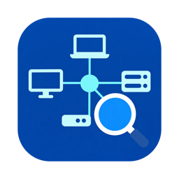
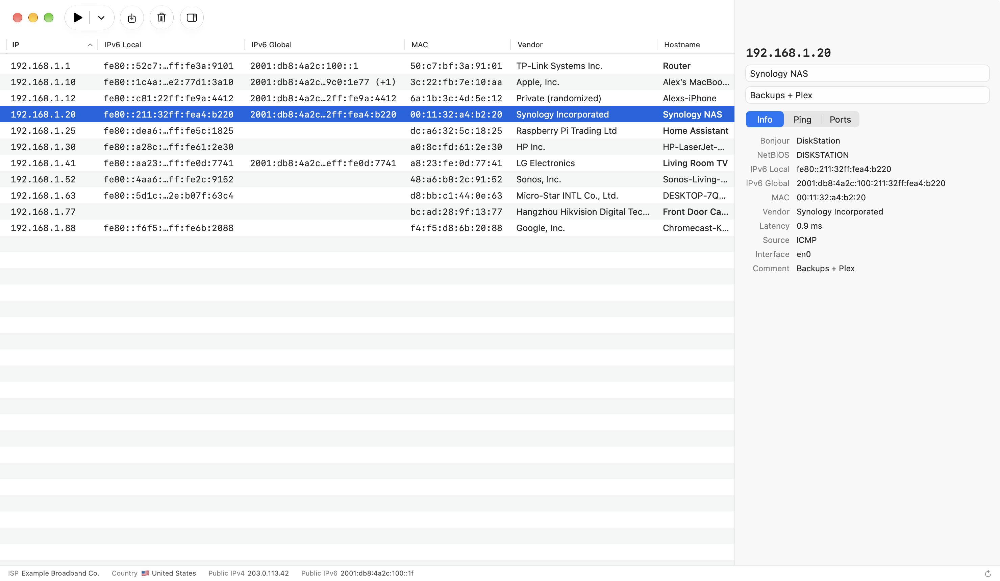
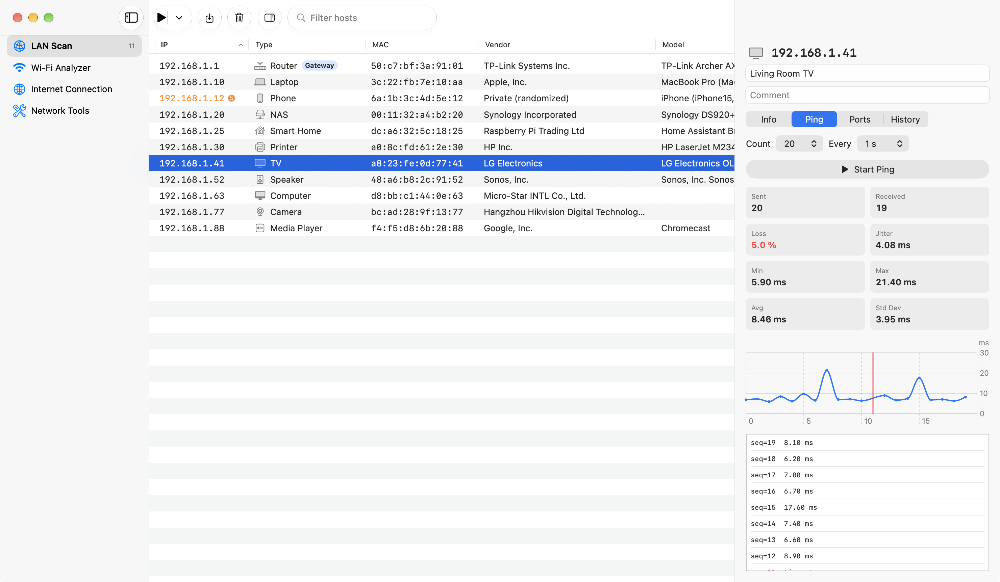
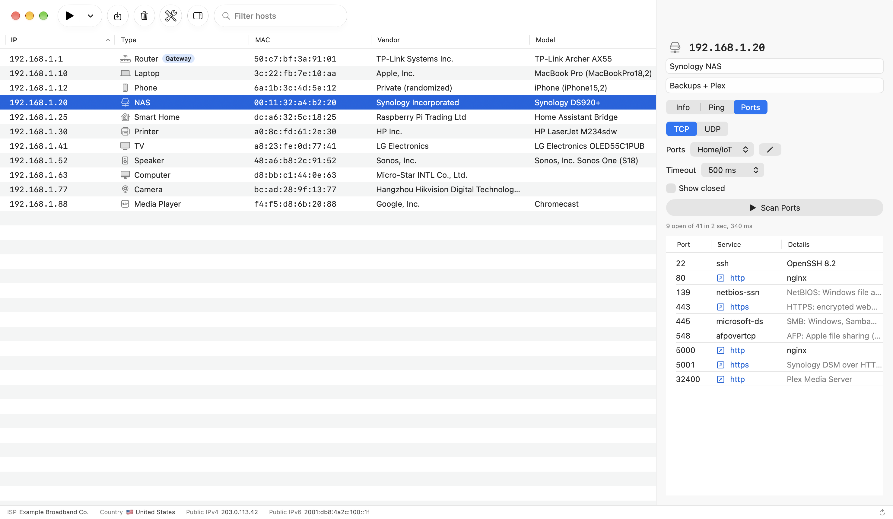
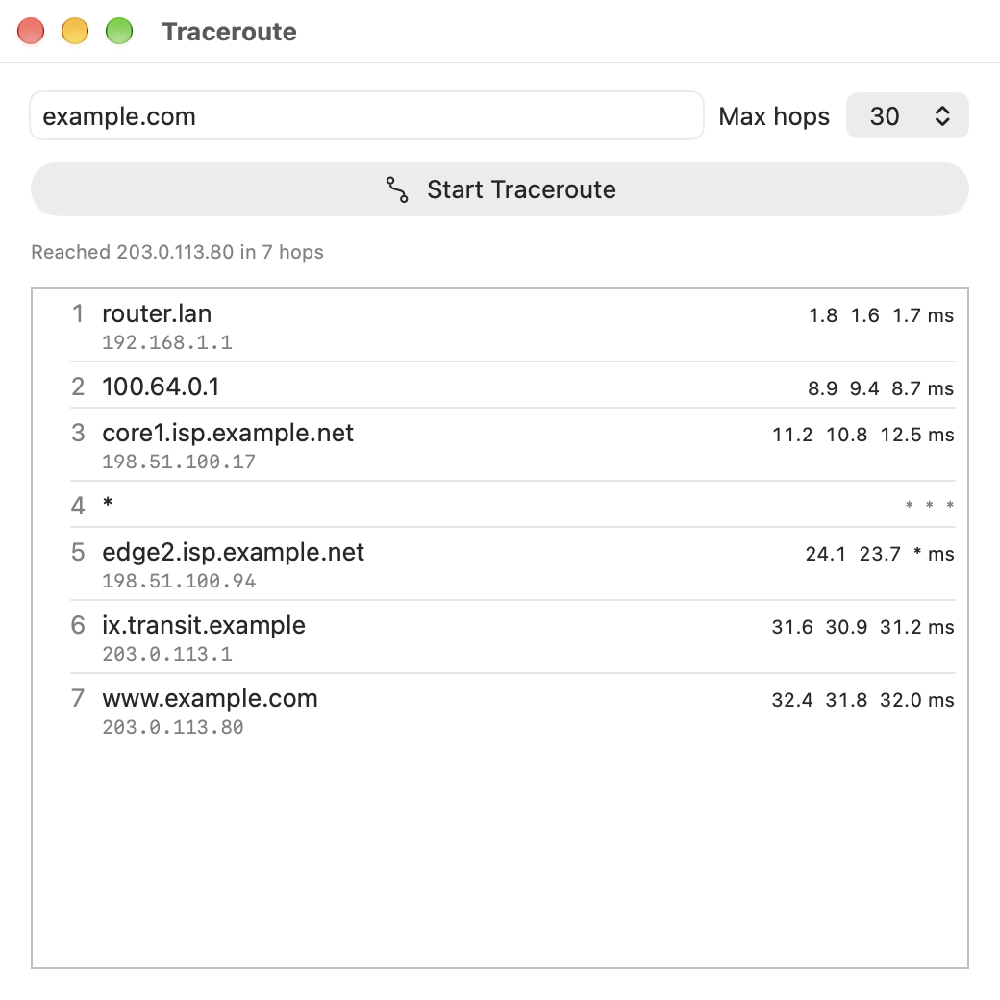
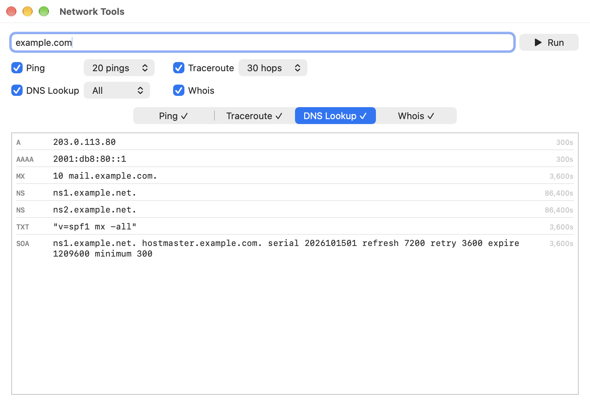

<p align="center">
  
</p>

<h1 align="center">NetScanner</h1>

<p align="center">
  A native macOS network scanner: discover every device on your LAN, see who it is, ping it and scan its ports.<br>
  SwiftUI · macOS 15+ · App Sandbox · no root required
</p>

---

## Overview

NetScanner sweeps the subnets of your Mac's network interfaces and lists every device that answers: its IPv4 and IPv6 addresses, MAC address, vendor, name and latency. Select a host to see everything that was detected about it, give it your own name and a comment, run a continuous ping with live statistics, or scan its TCP ports, with web interfaces turned into clickable links.

It runs entirely inside the macOS App Sandbox and needs no administrator privileges or helper tools.



## Features

### Host discovery
- Scans **all active interfaces at once**, each on its own subnet, or a single interface, or your **saved ranges** (`192.168.0.100-200`, `10.0.0.0/23`, single IPs, comma-separated).
- Finds hosts with **ICMP ping**, falling back to **TCP probes** for devices that ignore pings, and picks up silent devices from the ARP cache.
- Shows, per host:
  - **IPv4**, **IPv6 link-local** and **IPv6 global** addresses
  - **MAC address** and **vendor** (IEEE OUI database; randomized "private" MACs are flagged)
  - **Hostname**, resolved via **Bonjour/mDNS**, **NetBIOS** (Windows, Samba, NAS) and the router's **DNS**
  - **Latency** and how the host was found (ICMP, TCP, ARP)
- **Device identification:** each host gets a **type** (router, computer, phone, TV, media player, speaker, printer, NAS, camera, smart home…) with an icon, and a **model** when the device reveals it. Evidence comes from:
  - **Bonjour services** it advertises (AirPlay, Google Cast, IPP printing, HomeKit, SMB…) and their TXT records (e.g. `MacBookPro18,2`, `HP LaserJet M234`)
  - **UPnP/SSDP** device descriptions (manufacturer, model, friendly name)
  - the **title of its web interface** (e.g. "Synology DiskStation")
  - the default gateway, vendor and names as fallbacks
- **Your own names and comments** for each device, saved by MAC address, so they follow the device when DHCP hands it a new IP.
- **Filter** the table as you type (⌘F) by IP, MAC, vendor, model, type, any name, comment or service.
- **Choose your columns:** right-click the header to show or hide them; visibility, order and widths are remembered.
- **Device history:** every device is remembered across scans and launches (by MAC, or by IP when there's none): when it was **first** and **last seen**, and every IP address it has used. Sort by the **First Seen** column to spot devices that just joined your network.
- **IP changes:** when a device comes back with a different address than in the previous scan, its IP shows in orange with a ⇄ badge; hover it, or open the inspector's **History** tab, for the previous one.
- **Wake-on-LAN** from the context menu of any host with a known MAC.
- The **default gateway** is tagged in the table, and the scan summary lists it together with the **DNS servers** in use.
- Sortable table, **CSV export**, and copy actions for IP, IPv6, MAC and hostname.

### Ping
- Configurable count (or continuous) and interval.
- Live **aggregate statistics**: sent, received, **packet loss**, **min / avg / max**, **standard deviation** and **jitter**.
- RTT chart and a per-packet log.



### Port scanning
- Editable **port lists**. It ships with *Top 100* (nmap's most common ports), *Home/IoT* (NAS, media servers, cameras, home automation, TVs, printers, Apple devices), *1–1024* and *1–65535*, and you can add your own.
- For each open port: the service name, an open/closed indicator and a **Details** column with the **banner** the service announces (`OpenSSH 9.6p1`, the web server's `Server` header, FTP/SMTP/POP3/IMAP greetings, MySQL version) or, when it says nothing, a plain-English description of its typical use.
- **UDP scan** of common services: DNS, TFTP, NTP, NetBIOS, SNMP (reads `sysDescr` with community *public*), SSDP/UPnP, SIP, mDNS, CoAP and Ubiquiti discovery. Each port gets a real request of its protocol, so *open* means it answered; *closed* means an ICMP port-unreachable came back.
- **Automatic web detection.** Open ports that answer HTTP or HTTPS (including self-signed certificates) become **clickable links** that open in your browser, even on non-standard ports such as 8080, 8123 or 3000.



### Network tools
The toolbar's 🔧 button opens a **Network Tools** window: type a destination, check the tools to run and press **Run**. They run one after the other, each with its results in its own tab. They are meant for destinations outside your network: inside the LAN a traceroute is a single hop and whois knows nothing about private addresses.

- **Traceroute:** the route to any name or address, using the same unprivileged ICMP socket as ping (no root, no helper). Three probes per hop with their round-trip times, hop names from reverse DNS and Bonjour, and a maximum of 15, 30 or 64 hops.
- **DNS Lookup:** A, AAAA, CNAME, MX, NS, TXT, SOA, SRV and PTR records (or all the common ones at once) through the system resolver, with TTLs. An IPv4 address is looked up as PTR.
- **Whois:** domains and public IP addresses, starting at IANA and following referrals to the registry and the registrar.





### Public network info
A status bar shows your **ISP**, **country**, and **public IPv4 and IPv6** addresses. It refreshes automatically when your network changes. While a scan runs, it shows the scan progress instead.

## Using NetScanner

### Scanning
| Action | How |
|---|---|
| Scan every interface | Click **▶** in the toolbar, or press **⌘R** (also in the **Scan** menu) |
| Stop a running scan | Click **■** (the same button), or press **⌘R** again |
| Scan one interface | Click **⌄** next to ▶ (or open the **Scan** menu) and choose **Interface en0 — 192.168.1.0/24** |
| Scan a saved range | Click **⌄** (or open the **Scan** menu) and choose the saved scan |
| Create or edit saved ranges | Click **⌄** (or open the **Scan** menu) → **Customize…** |
| Clear the results | Click the 🗑 toolbar button |

Every scan replaces the previous results. Very large subnets (bigger than a /22) are narrowed to the /24 around your Mac's address; use a saved range to scan something else. Saved ranges are capped at 4,096 addresses.

The first scan triggers macOS's **Local Network** permission prompt. Allow it, or nothing will answer. If it was denied, NetScanner shows a banner with a button that opens System Settings.

### The host table
- Click a column header to sort. Click **First Seen** twice to list the newest devices first.
- Type in **Filter hosts** (or press **⌘F**) to narrow the list; every word must match.
- Right-click a column header to show or hide columns.
- Right-click a host to wake it (Wake-on-LAN) or copy its IP, IPv6 addresses, MAC or hostname. Edit its name and comment in the inspector.
- Custom names appear in bold in the **Hostname** column.

### The inspector (right panel)
Toggle it with the sidebar button in the toolbar. With **no host selected**, it shows a scan summary: hosts found per interface or saved scan, the total, the default gateway and the DNS servers.

With a host selected, the top shows its IP plus editable **Name** and **Comment** fields (saved as you type), and four tabs:

- **Info:** everything detected about the host: Bonjour, NetBIOS and DNS names, all IPv6 addresses, MAC, vendor, latency, discovery source and interface.
- **Ping:** pick a count and interval, then **Start Ping**.
- **Ports:** choose **TCP** or **UDP**. For TCP pick a port list (✏️ edits the lists) and a timeout, then **Scan Ports**. Hover a row to read the full banner and what the port is typically used for. Click an **http ↗ / https ↗** link to open the web interface, or double-click the row.
- **History:** every IP address the device has used (followed by its MAC), with when each was first and last seen. The current one is tagged **Current**, and the one it just left **Previous**.

### Network tools
Click 🔧 in the toolbar (the window is also listed in the **Window** menu).

1. Type a domain or IP address in **Destination**.
2. Check **Traceroute** (pick the maximum hops), **DNS Lookup** (pick a record type, or **All**) and/or **Whois**.
3. Press **Run**, Return or ⌘↩. The tools run in that order; each tab shows **…** while its tool runs and **✓** when it's done. **Stop** cancels the rest.

The window keeps the last results until you run it again.

### Status bar
Shows ISP, country flag and public IPs. Click ↻ to refresh them manually.

## Privacy

- Scanning, pinging and port scanning stay on your local network, unless you point a tool at an outside address yourself.
- The only automatic external request is to [ipinfo.io](https://ipinfo.io), to display your public IP, ISP and country in the status bar.
- DNS lookups go to the DNS servers your Mac already uses; whois queries go to whois.iana.org and the registry/registrar servers it refers to, only when you press **Whois**.
- Saved data stays on your Mac, in the app's sandbox container: known devices (names, comments, first/last seen, IP history) in a SwiftData store, settings (saved ranges, port lists, columns) in its preferences.

## How it works

- **Unprivileged ping.** Uses a `SOCK_DGRAM` + `IPPROTO_ICMP` socket, which macOS allows without root. The receive buffer is raised to 1 MB because the default (~8 KB) drops replies when hundreds of pings are in flight.
- **MAC and IPv6 neighbors.** Read from the kernel's ARP and NDP caches through the routing `sysctl`. Inside the sandbox (with Local Network access) this returns real MACs, while spawned `arp`/`ndp` tools only see redacted ones. An ICMPv6 ping to `ff02::1` fills the IPv6 neighbor cache first.
- **Names.** Bonjour (multicast reverse PTR lookup), NetBIOS node status (UDP 137) and unicast reverse DNS are queried in parallel; the first answer wins.
- **Identification.** A DNS-SD meta-query (`_services._dns-sd._udp`) finds every advertised service type; instances are resolved to IPs and their TXT records read. An SSDP `M-SEARCH` collects UPnP description URLs; when a device publishes several, the most informative one wins. The default gateway comes from the routing table. Rules then rank the evidence from strongest (model identifiers, services) to weakest (vendor, randomized MAC).
- **Traceroute.** Echo requests with an increasing `IP_TTL` on the unprivileged ICMP socket; the kernel delivers the routers' *Time Exceeded* errors, which quote our request, so each one is matched to its probe.
- **Banners.** Web ports reuse the `HEAD` response's `Server` header; other open TCP ports are read for the first bytes the server sends on its own.
- **UDP.** A connected UDP socket, so an ICMP port-unreachable surfaces as `ECONNREFUSED`; the request is retried once because UDP may drop it.
- **Web detection.** A `HEAD /` request is sent over TLS first, then plain TCP, so HTTPS ports aren't mistaken for HTTP.

## Requirements

- macOS 15 or later (designed for macOS 26)
- To build: Xcode 26 or later and [XcodeGen](https://github.com/yonaskolb/XcodeGen)

## Building from source

The Xcode project is generated from `project.yml` and isn't checked in.

```sh
brew install xcodegen          # once
git clone https://github.com/lsrur/NetScanner.git
cd NetScanner
xcodegen generate
open NetScanner.xcodeproj      # then ⌘R in Xcode
```

Or from the command line:

```sh
xcodebuild -scheme NetScanner -derivedDataPath build build
open build/Build/Products/Debug/NetScanner.app
```

Run the tests (unit tests plus integration tests against loopback and your LAN):

```sh
xcodebuild -scheme NetScanner -destination 'platform=macOS' -derivedDataPath build test
```

Regenerate the bundled lookup tables in `NetScanner/Resources/`:

```sh
scripts/update-oui.sh        # IEEE vendor database
scripts/update-services.sh   # service names from /etc/services
```

Debug builds also accept some environment variables, handy for screenshots: `NETSCANNER_AUTOSCAN=1` scans all interfaces on launch, `NETSCANNER_SELECT=<ip>` selects that host when the scan ends, and `NETSCANNER_SORT=firstSeen` starts with the newest devices first.
The README screenshots come from `NETSCANNER_DEMO=hosts|ping|ports|trace|dns|whois|new|summary`, which loads a fictional network (see `NetScanner/App/DemoData.swift`).

```sh
NETSCANNER_AUTOSCAN=1 build/Build/Products/Debug/NetScanner.app/Contents/MacOS/NetScanner
```

### Releasing

Bump `MARKETING_VERSION` in `project.yml`, commit and push, then:

```sh
scripts/release.sh                       # tests, universal Release build, dist/NetScanner-<version>.dmg
scripts/release.sh --publish             # same, then tags v<version> and creates the GitHub release
scripts/release.sh --publish --notes notes.md   # with your own release notes on top
```

`--publish` refuses to run unless the tree is clean, on `main`, in sync with `origin/main`, and the version hasn't been released yet. Builds are ad-hoc signed (no Developer ID), so the release notes explain how to get past Gatekeeper.

## License

MIT. See [LICENSE](LICENSE).
